# A Stage-Law Model of the IBIS Predriver for Short and Stressed Pulses

*Author names and affiliations*

*Abstract*—An IBIS model describes an output buffer by the I–V tables of its output devices and by the pad voltage of complete transitions, from which the conducting fractions  `K_{u}(t)`  and  `K_{d}(t)`  of the two devices are solved and replayed against time. When an input pulse is shorter than the buffer's own delay, the predriver interrupts the transition and the replay fails: on twelve test buffers HSPICE's native IBIS element misses the stressed pad peak by 20–100 %. This paper replaces the replay by a model of the predriver. Each predriver stage obeys a stage law derived from the α-power MOSFET model;  `K`  identical stages drive the gate of the output device, and a static map turns the gate into  `K_{u}` . The stage rates are fitted to the  `K_{u}(t)`  that the IBIS file already contains. The file cannot determine the stage count, the map shape or the stage threshold, which act only under partial drive; one measured pad waveform for a short pulse calibrates the threshold on its peak and selects among nine candidates on its shape. Built from the file and that one measurement, the model reproduces the stressed pad peak within 10 % (mean 6.9 %) on the twelve buffers at five pulse widths. The method relies on four built-in constants chosen on the test buffers, and was tested on single pulses into one load; both limits are stated.

*Index Terms*—IBIS, I/O buffer modeling, predriver, short pulses, α-power law, behavioral modeling, signal integrity.

## I. Introduction

An IBIS model [1] describes an output buffer from its pins: the I–V tables of the pull-up and the pull-down device, the pad voltage of one complete rising and one complete falling transition recorded into two fixtures [2], the die capacitance  `C_{comp}`  and the package. A simulator solves the two waveforms, instant by instant, for the conducting fractions  `K_{u}(t)`  and  `K_{d}(t)` , the multipliers on the two tables that reproduce the recorded pad voltage [3], and then replays them against time from the input edge. The IBIS-to-SPICE converter this work extends (the *converter* below) does this and writes the result as a SPICE subcircuit, the *existing model*. HSPICE's built-in IBIS element (the *native element*) derives its pull-up and pull-down scaling coefficients from two V–T waveforms in the same way [4] and is the baseline of this paper; Section IV-B lays its coefficient over the two-fixture solution. The proposed model is a subcircuit written by the same converter.

The coefficients describe complete transitions, which is all the file records. When an input pulse is shorter than the buffer's own delay and edge, the transition is interrupted inside the predriver, the chain of inverters between the input pin and the output devices: the gate of the output device turns back before it reaches its rail, and a coefficient replayed against time has no representation of that. Fig. 1 shows this on test buffer ex2, whose netlist can be probed. Under a complete transition (Fig. 1(a)) the gate of the output device reaches its rail and the replayed coefficient is the right one. For an 810 ps pulse (Fig. 1(b)) the gate turns back at 0.76 of its swing; the conducting fraction solved from the transistor's own fixture runs peaks at 0.88 and returns, while the native element replays the coefficient of the complete transition up to 1.26 (Fig. 1(c)), and its pad overshoots the measured peak by 71 % (Fig. 1(d)). Across the twelve test buffers of this work its worst stressed peak error is 20–100 % (Section V).

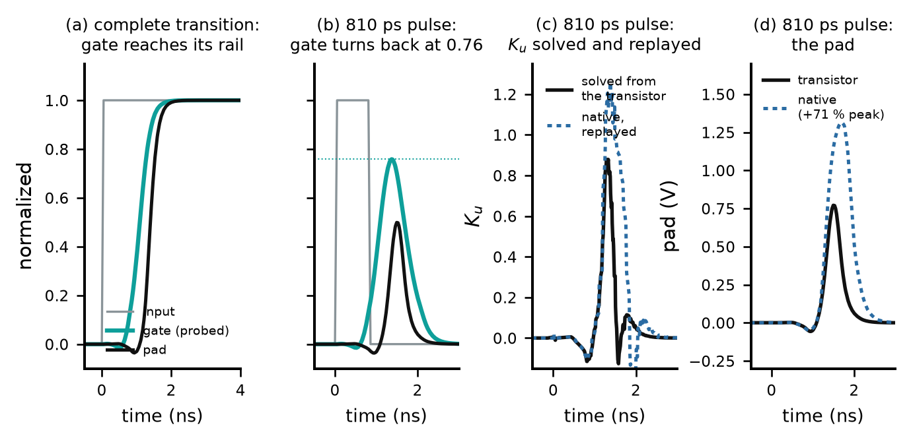

*Fig. 1. Where the replay fails, on test buffer ex2 at transistor level (the gate of the output device is probed for this figure only). (a) A complete transition: input pin, gate and pad, normalized; the gate reaches its rail. (b) An 810 ps input pulse: the gate turns back at 0.76. (c) The conducting fraction  `K_{u}`  solved from the transistor's own two fixture runs, against the native element's replayed coefficient; the solution is undefined within about 90 ps of the reversal, where the two fixtures are not in the same state. (d) The pad: transistor against the native element. Time is counted from the input edge.*

This paper replaces the replay by a model of the predriver. Each inverter of the predriver is modeled by a stage law derived from the α-power MOSFET model [5];  `K`  identical stages drive the gate of the output device, and a static map turns the gate into  `K_{u}` . The fractions then follow the gate rather than the clock: for a short pulse the gate turns back partway, and the model's  `K_{u}`  does the same. The stage rates are fitted to the  `K_{u}(t)`  that the file already contains, so the model needs nothing the file does not have, with one exception. A complete transition fixes the rates but not the quantities that act only under partial drive: the stage count, the shape of the map and the stage threshold. One measured pad waveform for a short pulse settles them.

The contributions are: (1) the stage law, a three-parameter normalized law of one predriver stage derived from [5], and the evidence that it extrapolates from a complete transition to truncated pulses; (2) an identification result, that the IBIS file determines the stage rates and leaves the stage count, the map shape and the threshold undetermined, shown in numbers; (3) a procedure that builds the model from the file and one stressed pad waveform, using the waveform's peak to calibrate the threshold and its shape to select among nine candidates; (4) verification at the pad on twelve test buffers, within 10 % of the transistor-level reference at five pulse widths, against 20–100 % for the native element.

Behavioral models of I/O buffers that go beyond the IBIS tables exist. Macromodels identified from the buffer's port waveforms, such as Mπlog [6], represent the buffer as a black box and offer improved accuracy and numerical efficiency, but they are built from the buffer's transient responses rather than from the IBIS file. Conversions of IBIS files into SPICE behavioral models [3] and the simulators' own IBIS elements [4] keep the file as the only input and replay its coefficients against time, which is the mechanism that fails here. This paper keeps the file as the primary input and inserts a model of the predriver between the input pin and the coefficients.

The rest of the paper follows the construction of the model. Section II derives the stage law from the α-power MOSFET model [5], because everything that follows rests on it. Section III assembles the buffer model: the chain of stages, the map from the gate to the conducting fraction, and the pad current. Section IV asks what the IBIS file determines and what it cannot, and gives the identification procedure step by step, with ex2 as the running example. Section V verifies the model, first at the gate, where the stage law is tested on its own, then at the pad on twelve buffers against the transistor-level reference and the native element. Section VI collects the approximations and limits, and Section VII concludes.

### A. Terms and Test Set

The test set is three buffers whose transistor netlists are available, ex2 (3.3 V, three predriver inverters), inv_chain (1.8 V, seven) and io_buf (3.3 V, separate pull-up and pull-down paths with one and three predriver stages), and nine variants of the first two, each changing one property of the silicon: ex2_base and inv_base8 are the two buffers rebuilt through the variant generator; ex2_weak and inv_weak halve the device widths (ex2: the output stage; inv_chain: every stage); ex2_skewp and inv_skewp halve the pull-up PMOS only; ex2_slowpre halves the predriver widths; ex2_nomiller removes the gate-to-drain capacitances of the output stage, the feedthrough that puts the small bump before the edge of a V–T curve [7, p. 64]; inv_stage4 has three predriver inverters instead of seven. The input edge is 50 ps on the three base buffers and 1 ps on the variants. Transistor-level HSPICE simulation is the reference, the model runs in ngspice, and the native element is the baseline. The method is not derived from the file alone: besides the one measurement it uses four built-in constants chosen on these buffers, which Section VI discusses.

*Terms used throughout.* The *settled swing* of a buffer is the pad excursion of a complete transition into the test load (50 Ω and 2 pF), between the settled level before the input edge and the settled level after the transition; on ex2 it is 1.55 V. A pulse is *stressed* when it is too short for the transition to complete, so that the pad turns back before reaching the settled level; its *depth* is the fraction of the settled swing the pad reaches. Every buffer is tested at the five pulse widths at which the transistor-level pad reaches about 50, 60, 70, 80 and 90 % of its settled swing, so a slower buffer is tested with longer pulses (ex2 810–975 ps, inv_chain 104–135 ps, io_buf 1505–2354 ps); the *calibration width* is the shortest of the five, at which the one measurement is taken. A quantity is *probed* when it is read from an internal node of the transistor-level simulation; the method never does this, and probed data appear only in tests of the method and in the figures that explain it. *File-only* describes what the method itself uses: the IBIS file, one pad waveform and the built-in constants. In the chain, a *handover* is the instant at which a stage's output crosses the threshold of the stage after it, which then starts to move. Table I lists the notation.

*TABLE I*

*Notation*

| **Symbol** | **Definition** | **Where** |
|---|---|---|
| `u` ,  `v` ​ | Normalized stage input and output, 0 → 1 | (8) |
| `v_{t}` ​ | Stage threshold:  `V_{TH}/V_{DD}`  in the derivation, an effective fitted number in the model | (9), (17) |
| `x_{0}` ,  `x_{lin}` ​ | Saturation boundary at full drive,  `V_{D0}/V_{DD}` ; the effective constant that replaces it (0.45) | (9), (18) |
| `h` ,  `r` ​ | Gate factor and drain factor of the stage law | (17), (18) |
| `s_{up}` ,  `s_{dn}` ​ | Charging and discharging rate of a stage, in swings per ns (one swing: the full excursion of  `v`  from 0 to 1) | (16) |
| `p` ,  `α` ​ | Gate exponent of the stage law (fixed at 1); the device's velocity-saturation index | (17), (2) |
| `K` ​ | Number of stages in the chain | (20) |
| `G_{UP}` ,  `G_{DN}` ​ | Gate of the output pull-up and pull-down device, 0 → 1 | (21) |
| `M` ,  `(v_{t,map},a)` ​ | The map from the gate to the conducting fraction, and its shape | (22) |
| `K_{u}` ,  `K_{d}` ;  `K̂_{u}` ​ | Conducting fractions of the output devices;  `K_{u}`  normalized between its settled levels | (22), (25) |
| `e(v_{t})` ​ | Relative error of the model's pad peak against the measured peak | (28) |
| `C_{comp}` ​ | Die capacitance: declared in the file, re-estimated from the file's own waveforms | (24), IV-B |

## II. The Stage Law

A predriver stage is a CMOS inverter driving the gate of the next. This section derives, from the α-power law MOSFET model [5], a normalized law for its output with three parameters per stage, (19). Equations are numbered consecutively. A reader willing to take (19) on trust may go to Section III.

### A. Node Dynamics

A predriver stage is a CMOS inverter whose output node, at voltage  `V_{o}` , drives a lumped capacitance  `C` . Kirchhoff’s current law at that node gives

```
C (dV_{o})/(dt)=I_{P}−I_{N}    (1)
```

where  `I_{P}`  is the pull-up (PMOS) current into the node and  `I_{N}`  is the pull-down (NMOS) current out of it. Equation (1) is the only physical law used; all remaining steps model  `I_{P}`  and  `I_{N}`  and change variables.

Fig. 2 draws the stage with these quantities: the two devices, the node, the load, the currents, and the normalized variables defined in Section II-C.

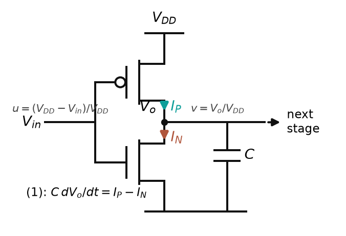

*Fig. 2. One predriver stage: a CMOS inverter whose output node  `V_{o}`  drives the lumped capacitance  `C`  and the gate of the next stage.  `I_{P}`  and  `I_{N}`  are the device currents of (1);  `u`  and  `v`  are the normalized input and output of (8).*

### B. Device Model

Each transistor is described by the α-power law [5]. For a device with gate–source voltage  `V_{GS}`  and drain–source voltage  `V_{DS}`  (magnitudes),

```
I_{D}={0,D=0 (cutoff)(I′_{D0})/(V′_{D0}) V_{DS},V_{DS}<V′_{D0} (triode)I′_{D0},V_{DS}≥V′_{D0} (saturation)    (2)
```

with

```
I′_{D0}=I_{D0} D^{α}    (3)
V′_{D0}=V_{D0} D^{α/2}    (4)
D=clip((V_{GS}−V_{TH})/(V_{DD}−V_{TH}), 0, 1)    (5)
```

Here  `I_{D0}`  and  `V_{D0}`  are the saturation current and saturation voltage at  `V_{GS}=V_{DD}` ,  `V_{TH}`  is the threshold, and  `α∈[1,2]`  is the velocity-saturation index ( `α=2`  recovers the long-channel square law;  `α→1`  for strongly velocity-saturated devices). The clip is our notation and does not appear in [5]: its lower bound is the cutoff row of (2) written into the drive, and its upper bound is a numerical guard for the chain of Section III-B, in which a stage output may overshoot its rail by a few percent for a few time steps. In the paper's own setting the gate never exceeds the supply and the upper bound is never reached.

Equation (2) has no single-expression form in [5]; the one used here follows from factoring  `I'_{D0}`  out of the triode row, so that the two conducting rows read

```
I_{D}=I'_{D0}⋅(V_{DS})/(V'_{D0})  (V_{DS}<V'_{D0}),
I_{D}=I'_{D0}⋅1  (V_{DS}≥V'_{D0})
```

In each row the multiplier of  `I'_{D0}`  is the smaller of 1 and  `V_{DS}/V'_{D0}` , and the rows meet at  `V_{DS}=V'_{D0}` . The conducting part of (2) is therefore

```
I_{D}=I′_{D0} min(1, (V_{DS})/(V′_{D0}))    (6)
```

Substituting (3) and (4) into (6),

```
I_{D}=I_{D0} D^{α} min(1, (V_{DS})/(V_{D0} D^{α/2}))    (7)
```

Equation (7) is the device model in the form used below: a full-drive current, a gate factor  `D^{α}` , and a drain factor that saturates at unity.

The device model (2)–(5) was checked against the transistors of the predrivers of two test buffers, simulated in HSPICE from their model cards at their drawn dimensions.  `V_{TH}`  and  `α`  are extracted as in [5, App. A];  `V_{D0}` , for which [5] gives no procedure, is the breakpoint that best fits the piecewise form (6) to the output curve at full gate drive. Table II lists the result and Fig. 3 shows the curves with the fit:  `α`  is 1.10–1.63, between the short-channel limit of 1 and the long-channel value of 2 [8], and the saturation voltage is 0.34–0.57 of the supply, comparable to the 0.5–0.55 used in [5].

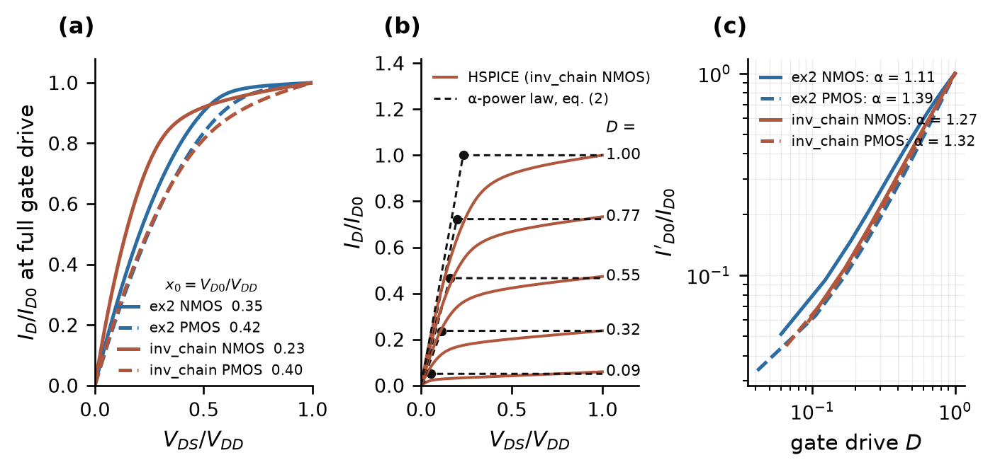

*Fig. 3. The device model (2)–(5) against HSPICE on the predriver transistors. (a) Output current at full gate drive against  `V_{DS}` , both normalized, with the breakpoint  `x_{0}`  of each device. (b) inv_chain NMOS: HSPICE output curves at five gate drives and the piecewise model (2). (c) Saturation current against gate drive on log scales; the slope is  `α` .*

*TABLE II*

*Device parameters of (2)–(5), extracted in HSPICE from the predriver transistors (ex2: the BSIM3v3 card hspice.mod; inv_chain: HL18G-S3.7S)*

| **Device** | `L` ​ | `V_{DD}` ​ | `x_{0}=V_{D0}/V_{DD}` ​ | `α` ​ |
|---|---|---|---|---|
| ex2 NMOS | 600 nm | 3.3 V | 0.472 | 1.10 |
| ex2 PMOS | 600 nm | 3.3 V | 0.559 | 1.63 |
| inv_chain NMOS | 180 nm | 1.8 V | 0.343 | 1.28 |
| inv_chain PMOS | 180 nm | 1.8 V | 0.569 | 1.41 |

### C. Normalization

Let the stage output move from its resting rail toward its destination rail, a distance  `V_{DD}` . Define, for a rising output,

```
v≜(V_{o})/(V_{DD}),  u≜(V_{DD}−V_{in})/(V_{DD})    (8)
```

so that  `v`  is the output’s progress toward its destination and  `u`  is the input’s progress toward the level that fully turns on the working (pull-up) device: for a rising output the pull-up PMOS does the work, and it is driven harder as the input falls, so u counts how far the input has come down from the supply. Both run from 0 to 1 during a transition. Define the normalized device constants

```
v_{t}≜(V_{TH})/(V_{DD}),  x_{0}≜(V_{D0})/(V_{DD})    (9)
```

A note on  `v_{t}` , because the symbol changes meaning. In (9) it is the device threshold as a fraction of the supply, 0.14–0.33 for the devices of Table II. From Section IV onward it is the threshold of a modeled stage, fitted to the file and then calibrated, and its fitted values (0.03–0.70 across the test buffers) are not device thresholds. The same symbol is kept because it plays the same role in (19).

With the PMOS source at  `V_{DD}`  and the NMOS source at ground, the four terminal voltages follow from (8):

```
|V_{GS,P}|=u V_{DD}, |V_{DS,P}|=(1−v) V_{DD}
V_{GS,N}=(1−u) V_{DD}, V_{DS,N}=v V_{DD}  (10)
```

Substituting (9) and (10) into (5),  `V_{DD}`  cancels and the gate drives of the two devices become

```
D_{P}=g(u),  D_{N}=g(1−u),  g(x)≜clip((x−v_{t})/(1−v_{t}), 0, 1)    (11)
```

Substituting (9) and (10) into the drain ratios of (7),

```
(|V_{DS,P}|)/(V_{D0})=(1−v)/(x_{0}),  (V_{DS,N})/(V_{D0})=(v)/(x_{0})    (12)
```

Applying (7) to each device with (11) and (12):

```
I_{P}=I_{D0,P} g(u)^{α} min(1, (1−v)/(x_{0} g(u)^{α/2}))    (13)
I_{N}=I_{D0,N} g(1−u)^{α} min(1, (v)/(x_{0} g(1−u)^{α/2}))    (14)
```

Equations (13)–(14) use one  `v_{t}` ,  `α`  and  `x_{0}`  for both devices; this is the same symmetric-device simplification adopted in [5, Sec. VI], where the two indices are averaged when they differ.

### D. Normalized Stage Dynamics

From (8),  `dV_{o}/dt=V_{DD} dv/dt` . Substituting this and (13)–(14) into (1) and dividing by  `C V_{DD}` :

```
(dv)/(dt)=s_{up} g(u)^{α}min(1,(1−v)/(x_{0} g(u)^{α/2}))
−s_{dn} g(1−u)^{α}min(1,(v)/(x_{0} g(1−u)^{α/2}))  (15)
```

where

```
s_{up}≜(I_{D0,P})/(C V_{DD}),  s_{dn}≜(I_{D0,N})/(C V_{DD})    (16)
```

Equation (15) is exact with respect to (1)–(5). Its parameters are dimensionless except  `s_{up}`  and  `s_{dn}` , which have units of swings per unit time, one swing being the full excursion of the stage output from 0 to 1 (the fitted values below are quoted per nanosecond);  `1/s_{up}`  is the time the stage would take to cross the full swing at its full-drive current. At  `u=1` , (15) reduces to a constant-slope ramp for  `1−v>x_{0}`  followed by an exponential approach with time constant  `x_{0}/s_{up}=C V_{D0}/I_{D0,P}` , which is the  `C_{L}R_{3}`  of [5, App. B].

Note that  `α`  appears twice in each term of (15): in the gate factor  `g^{α}`  and in the saturation boundary  `x_{0} g^{α/2}` .

### E. Reduction to the Stage Law

Two approximations reduce (15) to the form used in this work.

*A1 (gate exponent).* In (15) the gate factor is  `g(u)^{α}`  with the measured device exponent  `α` , 1.10–1.63 for the devices of Table II. The model keeps the form but treats the exponent as a parameter  `p` :

```
h(x)≜g(x)^{p}=clip((x−v_{t})/(1−v_{t}), 0, 1)^{p}  (17)
```

A full-swing waveform cannot set  `p` : the stage input dwells near  `g=1` , where  `g^{p}=1`  for every  `p`  (Section IV-D). In this work  `p=1`  is adopted, so (17) reduces to  `h(x)=g(x)` : A1 drops the measured exponent and makes the drive current linear in the gate above threshold, the short-channel limit of [5]. The parameter  `p`  is kept in the formula only so that the exponent can be restored if a measurement supplies it.

*A2 (fixed saturation boundary).* In (15) the boundary between the constant-current ramp and the resistive tail is  `x_{0}g^{α/2}` : it equals  `x_{0}`  at full drive and shrinks when the gate is only partly on. The model replaces it by a constant that does not depend on the gate:

```
r(x)≜min(1, (x)/(x_{lin}))  (18)
```

For a known device the natural value is  `x_{lin}=x_{0}` , and at  `g=1`  (18) then coincides with (15); the two differ only under partial drive. The model never knows the device, so the constant is given its own name:  `x_{lin}`  is an effective number, set to 0.45 in this work for the reasons given after Fig. 4, and the measured  `x_{0}`  of Table II (0.34–0.57) is only a check on it.

Applying (17) and (18) to (15) yields the stage law:

```
(dv)/(dt)=s_{up} h(u) r(1−v)−s_{dn} h(1−u) r(v)    (19)
```

Comparing (19) with (15) term by term:  `s_{up}`  and  `s_{dn}`  are unchanged;  `h(u)`  replaces  `g(u)^{α}`  (A1);  `r(⋅)`  replaces the drive-dependent drain factor (A2). The second appearance of the gate drive in (15), inside the boundary, is the only structural element removed.

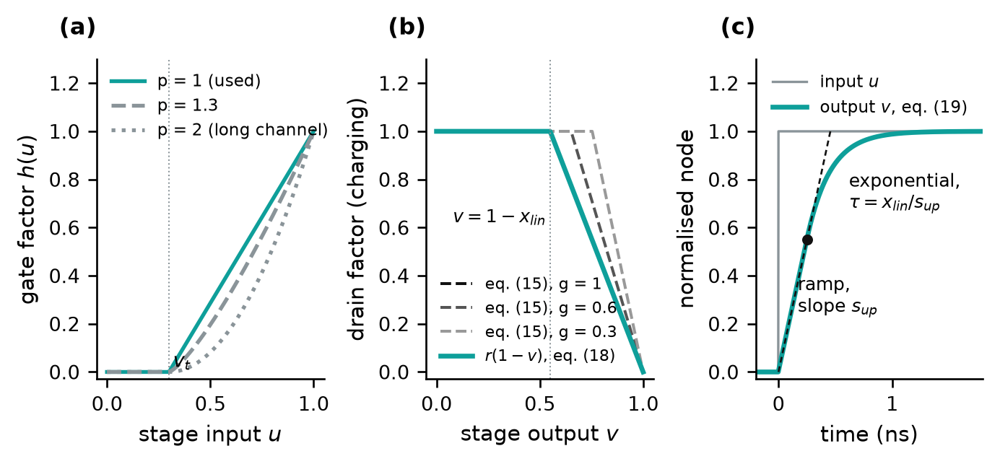

*Fig. 4. The stage law (19). (a) Gate factor  `h(u)`  of (17) for three exponents. (b) Drain factor of the charging term: the fixed boundary of (18) against the drive-dependent boundary of (15) at three gate drives ( `α=1` ,  `x_{0}=0.45` ). (c) One stage's response to an input step: a constant-slope ramp, then an exponential approach to the rail.*

The value  `x_{lin}=0.45`  is a built-in constant of the method, not a quantity read from the IBIS file. It was chosen during development from fits of (19) to the individual probed predriver stages of two test buffers (0.37–0.47 on ex2, 0.52–0.63 on inv_chain); fitted to the probed gate with  `x_{lin}`  free, the chain gives 0.41 and 0.48, the measured  `x_{0}`  of Table II is 0.34–0.57, and [5] uses 0.5–0.55. In the pad-level tests of Section V it is fixed at 0.45 on ten of the twelve buffers and fitted on inv_chain and io_buf; Section IV-D shows why the file constrains it only weakly. As a check that (19) is the model of [5] and not merely similar to it, one stage with  `p=α`  driven by a linear input ramp reproduces the closed-form delay of [5, eq. (5)] within 4 ps for input ramps of 0.05 to 0.8 ns.

For a falling output, (8) becomes  `v=(V_{DD}−V_{o})/V_{DD}`  and  `u=V_{in}/V_{DD}` ; (10) exchanges the P and N rows, and (19) is unchanged.

## III. The Buffer Model

Equation (19) describes one stage. This section assembles the buffer:  `K`  stages in a chain, the map from the gate of the output device to its conducting fraction, and the pad current, which is the existing model's and is unchanged.

### A. Signal Path

Fig. 5(a) shows the buffer as an IBIS file describes it. The input pin drives the predriver, a chain of inverters whose last node is the gate of the output stage; the output pull-up and pull-down devices drive the die node, which  `C_{comp}`  loads and the package connects to the pad. The file records the output stage (its I–V tables),  `C_{comp}` , the package and the pad voltage of complete transitions; it records nothing about the predriver, which is where a short pulse is interrupted.

Fig. 5(b) shows the signal path of the model. A comparator turns the input pin into a 0-or-1 command;  `K`  identical stages obeying (19) pass it along, each adding delay and rounding the edge; the output of the last stage is the gate of the output pull-up device on a 0-to-1 scale; a static map  `M`  turns the gate into  `K_{u}` , and its complement into  `K_{d}` ; and the fractions scale the I–V tables of the file to give the current into the die node, which  `C_{comp}`  and the package turn into the pad voltage. The proposed method replaces only how  `K_{u}(t)`  and  `K_{d}(t)`  are generated.

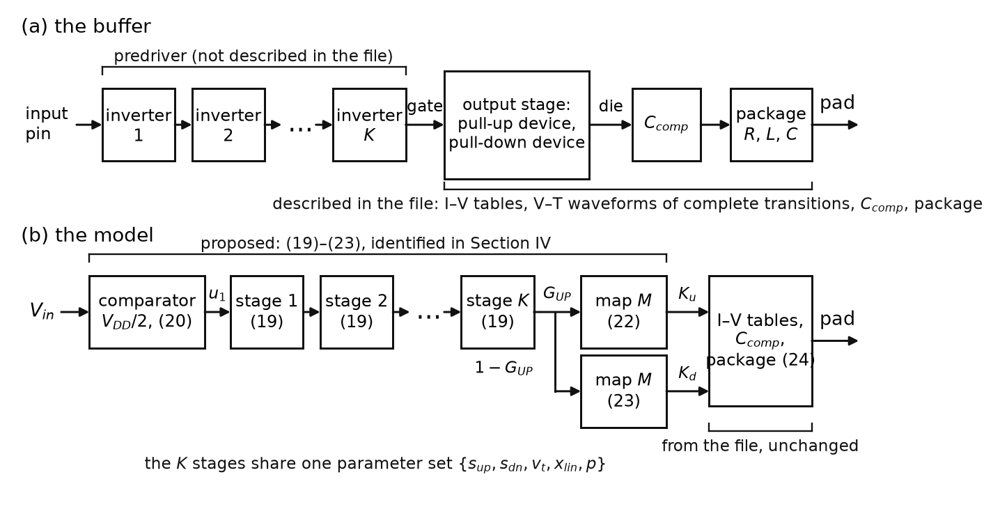

*Fig. 5. (a) The buffer as the IBIS file describes it: predriver, output stage, die node, package. (b) Signal path of the model. The teal blocks replace the way  `K_{u}(t)`  and  `K_{d}(t)`  are generated; the I–V tables,  `C_{comp}`  and the package are those of the IBIS file. Numbers in parentheses are equation numbers.*

### B. The Chain

The predriver is modeled as  `K`  stages, each obeying (19) with one shared parameter set  `{s_{up},s_{dn},v_{t},x_{lin},p}`  (approximation A3, identical normalized stages). Because (8) expresses every node as its own progress from 0 to 1, an inverting stage needs no sign: each stage's output is the next stage's input. The first stage is driven by a comparator on the input pin at half the supply, and the output of the last stage is the gate of the output pull-up device, with the pull-down gate its complement:

```
u_{1}(t)=1 if V_{in}(t)>V_{DD}/2, else 0;
u_{k+1}(t)=v_{k}(t), k=1,…,K−1  (20)
G_{UP}(t)≜v_{K}(t), G_{DN}(t)≜1−G_{UP}(t)  (21)
```

The comparator in (20) plays the part of the existing model's input stage, which also turns the pin into a command; the input edges of the test set, 50 ps and 1 ps, are short against the chain delay (about 1 ns on ex2), so the input's own shape is not modeled. The complement in (21) corresponds to an output stage whose two devices are driven from one predriver node, the case for ex2 and inv_chain and their variants. Where the two devices have separate predriver paths, as in io_buf, a second chain with its own stage count and parameters is fitted for  `G_{DN}` . An IBIS file does not state which structure a buffer has; in this work the choice was made from the netlists, and it is one input the user must supply (Section VI).

In words, a stage is a bucket: it fills at the rate  `s_{up}`  once the bucket before it is more than  `v_{t}`  full, drains at  `s_{dn}`  once that bucket has emptied below  `1−v_{t}` , and the flow tapers off within  `x_{lin}`  of the rim or the floor. A step at the input starts filling the first bucket at once; each later stage waits until the one before it passes  `v_{t}` . The delay of the chain is spent in these handovers, and the shape of its last edge is set by the rate. On the fitted ex2 chain (Fig. 6) the handovers come at 0.24 and 0.66 ns, the gate reaches the map's threshold at 1.11 ns, and the file's own  `K_{u}(t)`  leaves zero at 1.07 ns.

Fig. 6(b) shows why the stage count is a first-order parameter. For a pulse shorter than the chain's own delay, the input reverses while the later stages are still rising: each stage turns back before reaching its rail, the gate reaches only part of its swing (0.74), and because a stage delivers no current until its input passes  `v_{t}` , a pulse loses amplitude at every stage and is extinguished once its peak falls below  `v_{t}` . The abrupt cutoff is a property of the hard threshold in (17); in a transistor chain the loss is gradual. For the fits below, (19)–(21) are integrated with Heun's method [9] at 1 ps steps, which agrees with the ngspice [10] circuit model where explicit Euler at 2 ps did not; in the circuit model each stage is a behavioral current source charging a capacitor.

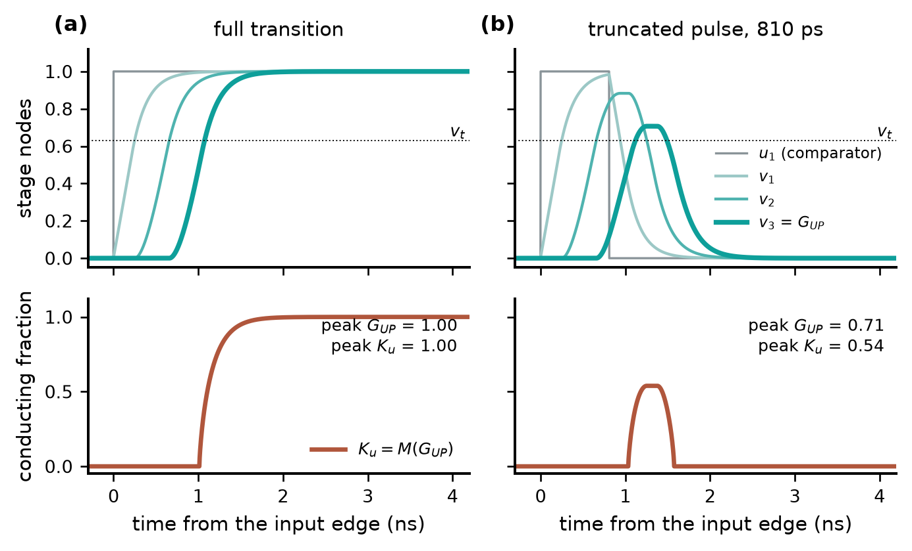

*Fig. 6. One chain, two inputs (ex2, probed-map setting:  `K=3` ,  `s_{up}=2.19` /ns,  `s_{dn}=2.12` /ns,  `v_{t}=0.487` ,  `x_{lin}=0.45` ). Top: the stage nodes of (19)–(21). Bottom: the conducting fraction obtained from the gate through the map (22). (a) Full transition. (b) An 810 ps input pulse: the gate turns back at 0.74 of its swing and  `K_{u}`  reaches 0.56.*

### C. The Map: From the Gate to the Conducting Fraction

The stage law produces the gate trajectory  `G_{UP}(t)`  and nothing else. An IBIS-based model needs at each instant the fraction  `K_{u}`  of the pull-up table that is conducting. A second relation, separate from the stage law, connects the two: with the gate only partly on, the output transistor delivers less than its table, and the reduction is taken to be one multiplier at every pad voltage,  `I(V_{pad},g)=K_{u}(g) I_{PU}(V_{pad})` , which is the assumption any  `K_{u}` -based model already makes. The map is the function  `K_{u}(g)` , a curve against the gate, not against time.

Where the gate node can be probed the curve can be measured: at each instant of a full transition the gate level and the file's  `K_{u}`  are read together and plotted against each other (Fig. 7(a), (b)). On the three buffers where this was done, the curve traced while the gate rises coincides with the one traced while it falls within 0.07–0.11, so  `K_{u}`  depends on the gate alone. The curve is described by a two-parameter formula scaled between the settled off and on levels of the file's own  `K_{u}`  and  `K_{d}` :

```
K_{u}(t)=k_{off}+(k_{on}−k_{off}) M(G_{UP}(t)),
M(g)≜clip((g−v_{t,map})/(g_{s}−v_{t,map}),0,1)^{a}  (22)
K_{d}(t)=d_{off}+(d_{on}−d_{off}) M(G_{DN}(t))  (23)
```

`v_{t,map}`  is the gate level at which the output device starts to conduct,  `a`  bends the curve between that point and  `g_{s}=1`  where the table is fully on (below 1, the curve rises steeply and then flattens), and  `k_{off}` ,  `k_{on}` ,  `d_{off}` ,  `d_{on}`  are the settled levels, close to 0 and 1. The same function  `M` , with the same shape, serves both devices in (22) and (23); only the levels differ. The form is borrowed from the gate factor (5), because the map describes how the output transistor turns on, but its parameters are empirical: fitted to the measured maps they are (0.57, 0.64) on ex2, (0.49, 0.60) on inv_chain and (0.50, 0.78) on io_buf, and they are distinct from the stage parameters  `v_{t}`  and  `p` , which describe the predriver.

The file does not contain the map. It gives  `K_{u}`  against time; the map is  `K_{u}`  against the gate; converting one into the other needs the gate against time, the one waveform an IBIS file does not have. The method therefore does not obtain the map from the file: it offers three fixed shapes (Fig. 7(c)) and leaves the choice among them to the stressed measurement (Section IV-E). The three are built-in constants: (0.50, 0.70) lies near the middle of the three measured maps; (0.40, 0.60) and (0.40, 0.90) were retained from an earlier search scored on the same twelve test buffers. Their generality is untested, and this is the least well founded element of the method.

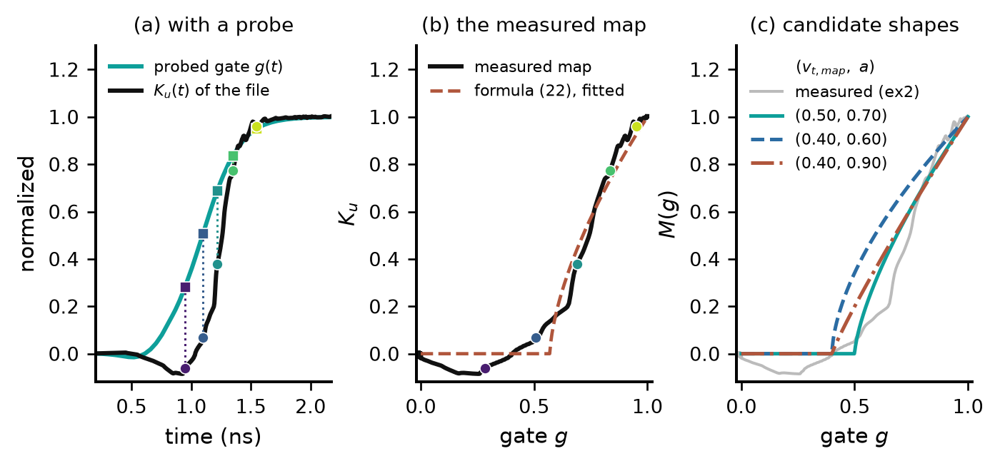

*Fig. 7. The map. (a) With the gate of ex2 probed, the gate level (squares) and the file's  `K_{u}`  (circles) are read at the same instants of a full transition. (b)  `K_{u}`  against the gate: the measured map, and the formula (22) fitted to it,  `(v_{t,map},a)=(0.57,0.64)` . (c) The three shapes offered when the gate cannot be probed, with the measured map of ex2 for reference.*

Fig. 8 shows the two relations evaluated one after the other on ex2: (19)–(21) give the gate, and (22) is applied to each of its values. For a full transition (top row) the gate sweeps its full range, the whole map is read, and the result can be compared with the file; this comparison is the fit of Section IV-C. For an 810 ps pulse (bottom row) the gate turns back at 0.74, only the lower part of the map is read, and  `K_{u}`  rises to 0.56 and returns to zero: a waveform no table of the file contains, produced by the same two relations with no additional parameter.

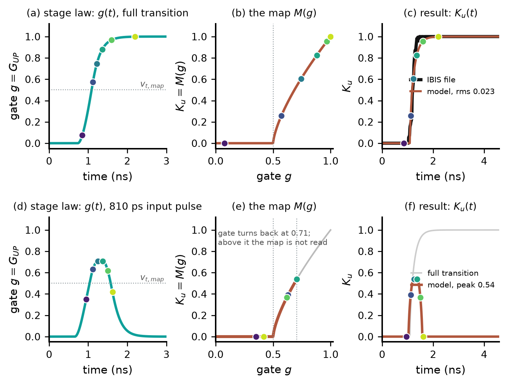

*Fig. 8. From the gate to the conducting fraction on ex2 (probed-map setting;  `K=3` , map (0.57, 0.64)). Left: the gate from the stage law. Middle: the map (22), with the gate values at six instants. Right: the resulting  `K_{u}(t)` . (a)–(c) Full transition, against the file's  `K_{u}(t)` . (d)–(f) An 810 ps pulse after calibration.*

### D. The Pad Current

The current delivered to the die node is that of the existing model,

```
I_{die}(t)=K_{u}(t) I_{PU}(V_{die})+K_{d}(t) I_{PD}(V_{die})
+I_{PC}(V_{die})+I_{GC}(V_{die})  (24)
```

where  `I_{PU}` ,  `I_{PD}`  are the pull-up and pull-down tables of the file, held at their end values outside the tabulated range, and  `I_{PC}` ,  `I_{GC}`  are the clamp tables, present only when the file contains them (io_buf does; ex2 and inv_chain do not).  `C_{comp}`  loads the die node and the package  `R` ,  `L` ,  `C`  connect it to the pad. Two details of the existing model are kept unchanged: the fractions pass through a first-order lag of 5 ps before they scale the tables, and a tabulated correction of up to about 0.1, indexed by the time since the input edge and fitted so that the replayed complete transition reproduces the solved curve, is added to the map output. Both belong to the existing model and are not part of the proposed method.

## IV. Identification from the File and One Measurement

### A. Overview

Fig. 9 draws the procedure and Table III lists it; the steps are numbered 0 to 4 throughout. The quantities of the model have four origins. The I–V tables and the package come from the file and are never changed;  `C_{comp}`  is declared in the file but is re-estimated from the file's own waveforms in step 0 (Section IV-B), because the solved  `K_{u}(t)` ,  `K_{d}(t)`  depend on it. The constants  `x_{lin}`  and  `p`  of the stage law and the three candidate map shapes are built in: their values were chosen during development with knowledge of the test buffers' transistors, and they are the method's assumptions. The stage rates  `s_{up}` ,  `s_{dn}`  and a first value of the threshold  `v_{t}`  are fitted to the file (step 1). The stage count  `K` , the map shape and the final  `v_{t}`  are settled by one measurement (steps 3 and 4). Applying the method to a new buffer needs the file, one pad measurement and one structural decision, whether the two output devices share a predriver node or have separate paths (Section III-B); it needs no other transistor-level information, but the method is not derived from the file alone.

Step 1 integrates (19)–(21) in Python, and a fit takes seconds. Steps 3 and 4 simulate the complete circuit model in ngspice, ten runs per candidate, about ninety per buffer. The result is a SPICE subcircuit written by the converter, in which each stage is a behavioral current source charging a capacitor and the map a piecewise-linear behavioral source, with the file's tables as in the existing model; it was run in ngspice and has not been tested in other simulators.

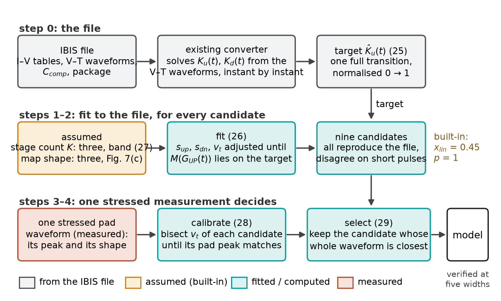

*Fig. 9. The procedure as a flow. Grey: from the IBIS file. Orange: assumed, built into the method. Teal: fitted or computed. Red: the one measurement.*

*TABLE III*

*The procedure ( `p=1`  fixed;  `x_{lin}=0.45`  fixed on ten of the twelve buffers, fitted on two)*

| **Step** | **What is determined** | **Data used** | **Eq.** |
|---|---|---|---|
| 0 | I–V tables, package;  `C_{comp}`  estimated; full-swing  `K_{u}(t)` ,  `K_{d}(t)`  solved with it; the normalized target | IBIS file, converter | (24)–(25) |
| 1 | `s_{up}` ,  `s_{dn}` , initial  `v_{t}` , per candidate stage count and map shape | full-swing  `K_{u}(t)`  of the file | (26) |
| 2 | Candidates: three stage counts × three map shapes | fit residuals of step 1 | (27) |
| 3 | `v_{t}` , for each candidate | peak of one stressed pad waveform | (28) |
| 4 | Stage count  `K`  and map shape | the same waveform, whole shape | (29) |

ex2 is the running example, in two settings, and every figure and table names the one it uses. In the *probed-map setting* (Fig. 6, Fig. 8, Fig. 10–Fig. 14, Table V) the map shape and  `C_{comp}`  are those measured on its netlist, (0.57, 0.64) and 1.7 pF, so that the model's gate can be compared with the probed gate; these figures explain the fit and are not part of the procedure. In the *file-only setting* (Table IV, Table VI, Fig. 15, Fig. 16 and Section V-B) only what the file and one measurement provide is used:  `C_{comp}`  estimated from the file (2.64 pF) and the three candidate shapes. Numbers of the same name differ between the settings: the one-stage residual is 0.083 in the first and 0.092 in the second, the fitted threshold 0.528 and 0.700.

### B. Step 0: The Target

The only curve the stage law is ever fitted to is the file's own conducting fraction through one complete transition. The converter obtains it from the two fixtures the specification prescribes [1], [2]: at each instant of the rising transition the current into the die node must balance in both, with  `V_{i}(t)`  the pad voltage recorded in fixture  `i` ,

```
K_{u}(t) I_{PU}(V_{i}(t))+K_{d}(t) I_{PD}(V_{i}(t))
=(V_{fix,i}−V_{i}(t))/(R_{fix})−C_{comp}(dV_{i})/(dt), i=1,2
```

(the clamp currents join the right-hand side when the file has them). Two equations in two unknowns are solved at every sample, for the rising and for the falling transition (Fig. 10(a), (b)). This is the standard two-waveform solution [3] and is not part of the proposed method.

*The die capacitance.* The right-hand side subtracts the displacement current of  `C_{comp}` , so the solved fractions depend on the value assumed for it, and a value that is too large books capacitor current as device current: the solved  `K_{u}`  then exceeds 1, which asks the pull-up device for more current than its table holds. On ex2 the declared 5.0 pF gives a peak  `K_{u}`  of 1.24 (Fig. 10(c)). The method therefore re-estimates  `C_{comp}`  from the file itself: the peak of the solved  `K_{u}`  is computed for a range of assumed values, and the rising branch of that curve (between 1.05 and 1.35) is extrapolated back to  `K_{u}=1` , as a threshold voltage is read from a transfer curve. The estimate, 2.64 pF on ex2, replaces the declared value on every buffer, upward or downward (Table IV, second column). A measurement on the netlist, which the method never uses, gives 1.70 pF for ex2; the probed-map setting uses that value.

The native element derives its own coefficients from the same two waveforms [4] and exposes them through its xv_pu and xv_pd outputs. Read through them during the same 10 ns transition, its  `K_{u}`  follows the solved curve within 0.003 rms (Fig. 10(b)), which is what Section I means by the same replay inside the simulator.

The existing model reproduces the solution: driven through one 10 ns input pulse, its internal node carrying the table value follows the solved  `K_{u}(t)`  within 0.015 rms on ex2 once aligned on the input edge. The target is read from that node rather than from the solved curve directly, so that the fit sees  `K_{u}`  exactly as the circuit replays it, with the converter's settled levels and lag, on the time base of the circuit's own input comparator, which also drives the chain, (20). The target is the node's value normalized between its settled off level at  `t_{rest}`  and its settled on level at  `t_{on}` :

```
K̂_{u}(t)=clip((K_{u}(t)−K_{u}(t_{rest}))/(K_{u}(t_{on})−K_{u}(t_{rest})),0,1),
t_{rest}=4.5 ns, t_{on}=12 ns  (25)
```

with the input edge at 5 ns, sampled every 2 ps from 4 to 21 ns. During the fit the chain receives the same 10 ns pulse as an ideal step at the mid-point of the input edge, (20), so that the rising edge of the target constrains  `s_{up}`  and the falling edge  `s_{dn}` . Nothing in this curve says how many stages produced it or where their thresholds lie; that is the subject of Section IV-D.

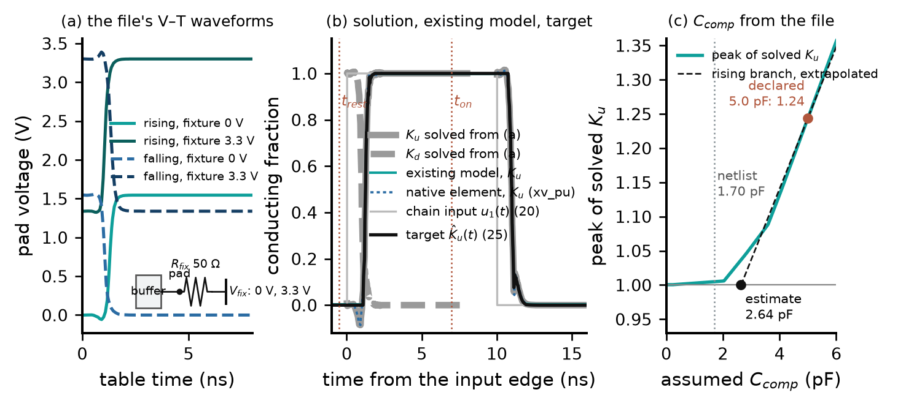

*Fig. 10. The target on ex2 (probed-map setting, 1.7 pF). (a) The file's V–T waveforms: one rising and one falling transition, each recorded into two fixtures (inset: the fixture, pad,  `R_{fix}` ,  `V_{fix}` ). (b)  `K_{u}(t)` ,  `K_{d}(t)`  solved from (a) by the converter (grey), the existing model's  `K_{u}`  through a 10 ns pulse (teal), the native element's own coefficient through the same pulse (blue, dotted), and the normalized target (25) with the chain input (20). (c) The estimate of  `C_{comp}`  from the file: the peak of the solved  `K_{u}`  against the assumed  `C_{comp}` , with the declared value, the estimate (the rising branch extrapolated to 1) and the value measured on the netlist.*

### C. Step 1: Fitting the Stage Law Through an Assumed Map

For an assumed stage count  `K`  and an assumed map shape, one of the three of Fig. 7(c), the stage parameters minimize the root-mean-square mismatch between the model's conducting fraction and the target:

```
{s_{up},s_{dn},v_{t}}^{⋆}=argmin R, x_{lin}, p fixed
R=rms_{t}[M(v_{K}(t))−K̂_{u}^{file}(t)]  (26)
```

with  `0≤v_{t}≤0.7` ;  `R`  is the residual. The map is an input to the fit and not a result of it. The residual is accumulated almost entirely within the two edges of the target, each about 0.7 ns wide on ex2, because the curve is flat at 0 or 1 elsewhere; a residual of 0.023 means that, averaged over the window, the model is 2.3 % of the full swing away from the file, most of it a small timing and shape difference at the edges. For a buffer with a separate pull-down path, the pull-down chain is fitted in the same way to  `K_{d}(t)`  through its own map.

*What each number does.* Fig. 11(a)–(c) varies one fitted number at a time around the fitted values.  `s_{up}`  is the charging rate of every stage: a larger value brings the rising edge earlier and makes it steeper.  `s_{dn}`  does the same for the falling edge.  `v_{t}`  is the level a stage's input must reach before the stage starts: at fixed rates it moves the edge in time without changing its steepness. Panel (d) builds a fit one number at a time from a poor first guess: adjusting  `s_{up}`  takes the residual from 0.296 to 0.201,  `s_{dn}`  to 0.060, and  `v_{t}`  to 0.023.

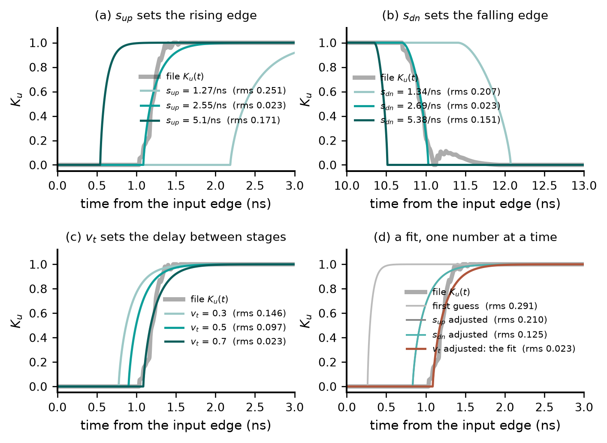

*Fig. 11. The fit (26) as three knobs, on ex2 (probed-map setting:  `K=3` , map (0.57, 0.64),  `x_{lin}=0.45` ). (a)–(c) The model's  `K_{u}(t)`  as  `s_{up}` ,  `s_{dn}`  and  `v_{t}`  are varied one at a time around the fitted values; (b) is the falling edge at 10 ns. (d) A fit built one number at a time.*

*How the minimum is found.* The residual is not differentiable (the chain is a simulation with thresholds and clips), so (26) is minimized by Nelder–Mead [11]: a simplex of four trial points that is reflected away from its worst corner, extended when that helps, contracted when it does not, and shrunk towards its best corner when nothing helps. The rates are searched on a logarithmic scale,  `v_{t}`  linearly within its bounds; the search stops when the simplex has collapsed or after 800 iterations, and it is run from three starts,  `s_{up}=s_{dn}=2` , 8 and 30 per ns. Fig. 12 shows the search on ex2. The valley is narrow in the rates (a 27 % change in  `s_{up}`  triples the residual) and shallow along  `v_{t}`  on the low side (0.128 at  `v_{t}=0` , 0.026 at 0.54, 0.091 at the 0.7 bound). The three runs took 100, 132 and 142 evaluations, and only the run from 2 per ns reached the minimum (0.0233); the others stopped in side valleys at 0.066 and 0.22. The procedure keeps the best of the three; the search is local, and one start is not enough.

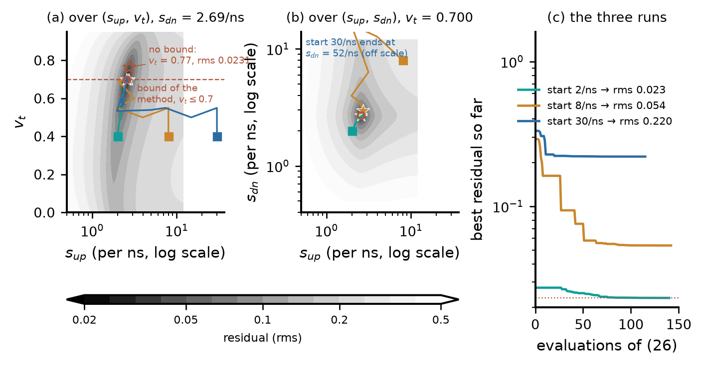

*Fig. 12. The search on ex2 (probed-map setting). (a) The residual of (26) over  `s_{up}`  and  `v_{t}`  at the fitted  `s_{dn}`  and (b) over  `s_{up}`  and  `s_{dn}`  at the fitted  `v_{t}` ; darker is lower. Squares: the three starts; stars: where each run ended; red circle: the fit. (c) The best residual against the number of evaluations.*

*Why several stages.* With a single stage, one number sets both the delay and the edge. On ex2 the file's  `K_{u}(t)`  starts 1.1 ns after the input edge and rises in 0.66 ns, which no single value of  `s_{up}`  can give: the best one-stage fit has a residual of 0.083 against 0.023 for three stages. With several identical stages the delay is spent in the handovers and the edge belongs to the last stage, so delay and edge are set separately. This is the reason for the chain, and also why the stage count cannot be read from the fit: beyond the minimum number, more stages redistribute the same delay (Section IV-D).

*TABLE IV*

*The fit (26) on the twelve test buffers in the file-only setting, for the selected stage count and map shape ( `C_{comp}` : declared in the file → estimate used;  `x_{lin}`  = 0.45 except inv_chain (0.28) and io_buf (0.41), fitted; last column: after step 3)*

| **Buffer** | `C_{comp}`  (pF) | `K` ​ | **Map shape** | `s_{up}`  (/ns) | `s_{dn}`  (/ns) | `v_{t}`  fitted | **Residual** | `v_{t}`  calibrated |
|---|---|---|---|---|---|---|---|---|
| ex2 | 5 → 2.64 | 3 | (0.5, 0.7) | 2.55 | 2.69 | 0.700 | 0.0233 | 0.632 |
| ex2_base | 5 → 2.49 | 3 | (0.5, 0.7) | 2.54 | 2.70 | 0.700 | 0.0224 | 0.632 |
| ex2_slowpre | 5 → 4.65 | 3 | (0.5, 0.7) | 1.63 | 1.84 | 0.427 | 0.0236 | 0.413 |
| ex2_skewp | 5 → 1.44 | 3 | (0.5, 0.7) | 2.67 | 2.81 | 0.700 | 0.0329 | 0.604 |
| ex2_weak | 5 → 1.27 | 3 | (0.5, 0.7) | 2.88 | 2.84 | 0.699 | 0.0259 | 0.626 |
| ex2_nomiller | 5 → 2.3 | 3 | (0.5, 0.7) | 2.54 | 2.70 | 0.699 | 0.0219 | 0.632 |
| inv_chain | 0.468 → 0.66 | 6 | (0.4, 0.9) | 19.34 | 18.97 | 0.700 | 0.0078 | 0.582 |
| inv_base8 | 0.468 → 0.37 | 7 | (0.4, 0.6) | 23.76 | 24.00 | 0.610 | 0.0065 | 0.539 |
| inv_stage4 | 0.468 → 0.43 | 3 | (0.4, 0.9) | 25.61 | 24.67 | 0.700 | 0.0061 | 0.626 |
| inv_skewp | 0.468 → 0.24 | 7 | (0.4, 0.6) | 22.36 | 21.20 | 0.537 | 0.0094 | 0.473 |
| inv_weak | 0.468 → 0.35 | 7 | (0.4, 0.6) | 22.96 | 23.52 | 0.630 | 0.0064 | 0.571 |
| io_buf | 1.2 → 1.68 | 1 | (0.5, 0.7) | 0.40 | 1.99 | 0.699 | 0.0186 | rates × 1.10 |

*Result.* On ex2 with  `K=3`  in the probed-map setting, (26) gives  `s_{up}=2.19` /ns,  `s_{dn}=2.12` /ns and  `v_{t}=0.528`  at a residual of 0.023 (Fig. 8(c)). Table IV gives the fit on all twelve buffers in the file-only setting, for the stage count and map shape the procedure finally selected: residuals 0.006–0.033. On 8 of the twelve the fitted  `v_{t}`  sits on its upper bound: with these map shapes the fit would place the handovers even later than the bound allows, and the calibration of step 3 then lowers  `v_{t}`  on every buffer calibrated through the threshold (last column). This is the non-identifiability of the threshold seen from the other side (Section IV-D): the file pushes  `v_{t}`  to wherever the assumed map lets the composition match, and the measurement puts it where the short pulse says. io_buf's single-stage chain could not reach the measured peak by its threshold alone and was calibrated through the fallback of step 3, a common scale on its two rates (Section IV-E).

### D. What the File Cannot Determine

A complete transition is two edges. Two edges fix two rates and one delay, and the fit has exactly those three numbers to spend. Anything that acts only when a transition is cut short, how many stages share the delay, where each hands over, how the output transistor turns on in between, leaves no mark on a complete transition. This subsection shows it in numbers.

*The map.* Table V gives the residual of (26) on ex2 and inv_chain for six assumed shapes. It varies by 11 % and 8 % across them, and its small preference does not point at the measured map: on ex2 the shape nearest the measured one, (0.6, 0.6), has the largest residual. Fig. 13 shows why. Through the later-starting map (0.6, 0.6) the fit gives  `v_{t}=0.479` ; through the earlier-starting map (0.4, 0.6) it gives  `v_{t}=0.678` , a gate that leaves later; for a full transition the two are indistinguishable (residuals 0.0238 and 0.0227). Driven by an 810 ps pulse they are not: the first delivers a conducting fraction of 0.51, the second none at all, because its higher threshold extinguishes the pulse inside the chain. Two models that the file cannot tell apart give opposite answers for the short pulse.

*TABLE V*

*Residual of (26) for six assumed map shapes (probed-map setting;  `K=3`  for ex2, 7 for inv_chain)*

| Shape  `(v_{t,map},a)` | **(0.3, 0.6)** | **(0.4, 0.6)** | **(0.4, 0.9)** | **(0.5, 0.7)** | **(0.6, 0.6)** | **(0.6, 0.9)** |
|---|---|---|---|---|---|---|
| ex2 | 0.0220 | 0.0227 | 0.0214 | 0.0226 | 0.0238 | 0.0226 |
| inv_chain | 0.0078 | 0.0078 | 0.0078 | 0.0079 | 0.0084 | 0.0082 |

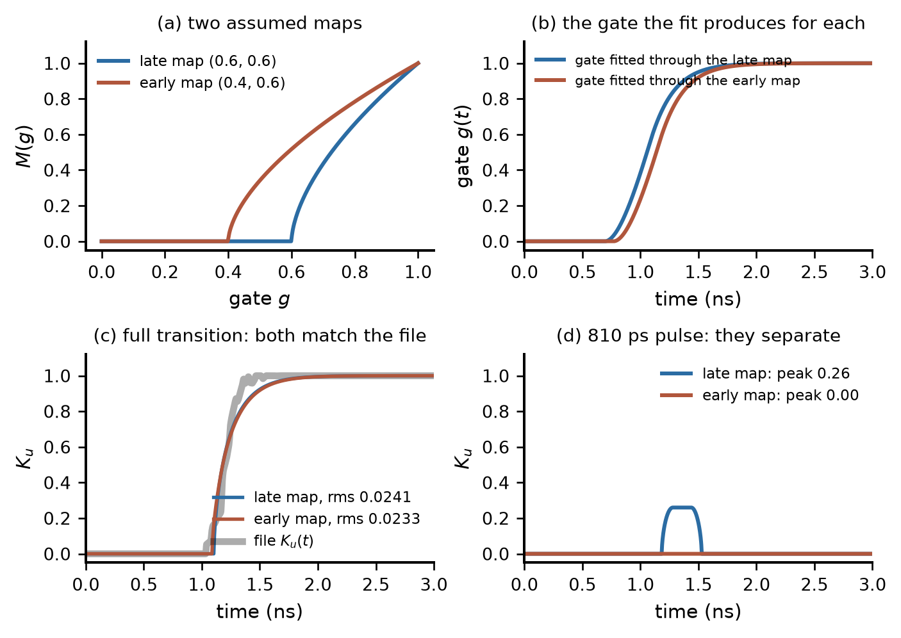

*Fig. 13. Two assumed maps on ex2 ( `K=3` ,  `C_{comp}`  1.7 pF), each with the stage law fitted through it to the same file. (a) The maps. (b) The gate each fit produces. (c) Full transition: both reproduce the file. (d) An 810 ps pulse, before calibration: one passes it, the other extinguishes it.*

*The stage count.* Fig. 14 gives the residual of (26) against  `K`  for the thirteen predriver chains of the twelve test buffers, each  `K`  fitted independently; the netlists are available, so the true count is known.  `K=1`  fails on ex2 and inv_chain (0.083 and 0.047 against 0.02 and 0.007), so the full swing does constrain the rate. Beyond that the residual is flat: on ex2,  `K=3`  to 6 lie within 0.002 of each other and the minimum is at  `K=5`  although the netlist has three stages; on inv_chain,  `K=6`  to 9 differ in the fourth decimal. The margin between the best and the second-best  `K`  is at most 0.0007 on twelve of the thirteen chains; only io_buf's single-stage pull-up has a distinct minimum. The procedure therefore keeps a band of stage counts instead of a point estimate, the three smallest whose residual is within 25 % of the best:

```
band=the three smallest K
with rms(K)≤1.25 min_{K'} rms(K')  (27)
```

On the twelve test buffers the band contains the netlist stage count in every case. The tolerance and the band width were chosen on these same buffers, so this is a property of the rule as tuned and not an independent validation.

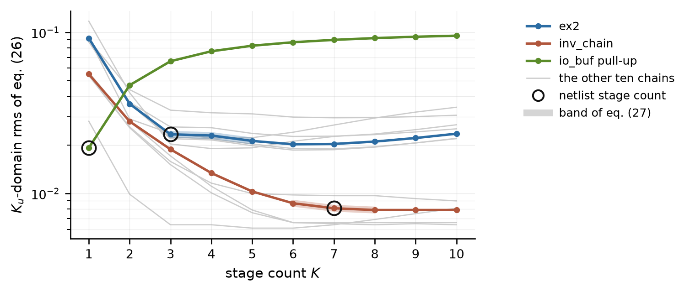

*Fig. 14. Residual of (26) against stage count for the thirteen predriver chains of the twelve test buffers (probed-map setting; io_buf has two chains). Circles mark the netlist stage count; the thick segments mark the band (27).*

*The threshold, the exponent, the boundary.* The fitted  `v_{t}`  of ex2 is 0.528 in the probed-map setting and 0.700, on its bound, in the file-only setting, both with  `K=3`  and at the same residual, 0.0233; in the file-only setting with  `K=5`  it is 0.065 at 0.0212. The threshold slides with the map and the stage count while the residual barely moves. At full swing each stage input dwells at the rail, where (17) does not depend on  `p` : in gate-domain fits of the individual probed stages of ex2 and inv_chain (the setting of Section V-A) every  `p`  between 1 and 2 reaches a residual of 0.002–0.007. If  `x_{lin}`  is left free in (26) it settles at 0.206 on ex2 and 0.135 on inv_chain, less than half the measured  `x_{0}`  of Table II, and replacing (18) by the drive-dependent boundary of (15) changes the residual by about 1 % on ex2 and not at all on inv_chain. This is why  `x_{lin}`  and  `p`  are held fixed rather than fitted. A fit with every stage free is worse than uninformative: on ex2 with  `K=2`  and all eight parameters free (a gate-domain fit), the full-swing residual against the probed gate falls below that of the identical-stage fit with the correct  `K=3` , with one very slow stage and one fast one, and such a chain extinguishes short pulses (stressed gate peak 0.228 where 0.758 is measured). Sharing one parameter set (A3) removes this solution and leaves  `K`  as the single structural unknown, chosen within the band (27) by the measurement.

### E. Steps 2–4: The Single Stressed Measurement

After step 1 there is not one model but several, and all of them reproduce the file. They differ in exactly the quantities that decide what happens when the input is cut short, so one measured short pulse can tell them apart. Fig. 15(b) shows how far they disagree: for ex2 the nine candidates of step 2, three stage counts from the band (27) × three map shapes, each fitted to the same file, driven by the same 810 ps pulse, give pad peaks from 0.01 to 1.28 V against 0.77 V measured. The measurement is the pad voltage for one short input pulse into a known load (Fig. 15(a)); nothing inside the buffer is observed. It is taken at the calibration width, the pulse width at which the pad reaches about 50 % of the settled swing into 50 Ω and 2 pF, the deepest of the five test depths; a user finds it by shortening the pulse until the pad peak is about half the settled swing (deeper pulses were not tested, Section V-C). In the tests below it comes from a transistor-level simulation; for a user it would be a bench measurement or a waveform supplied by the vendor.

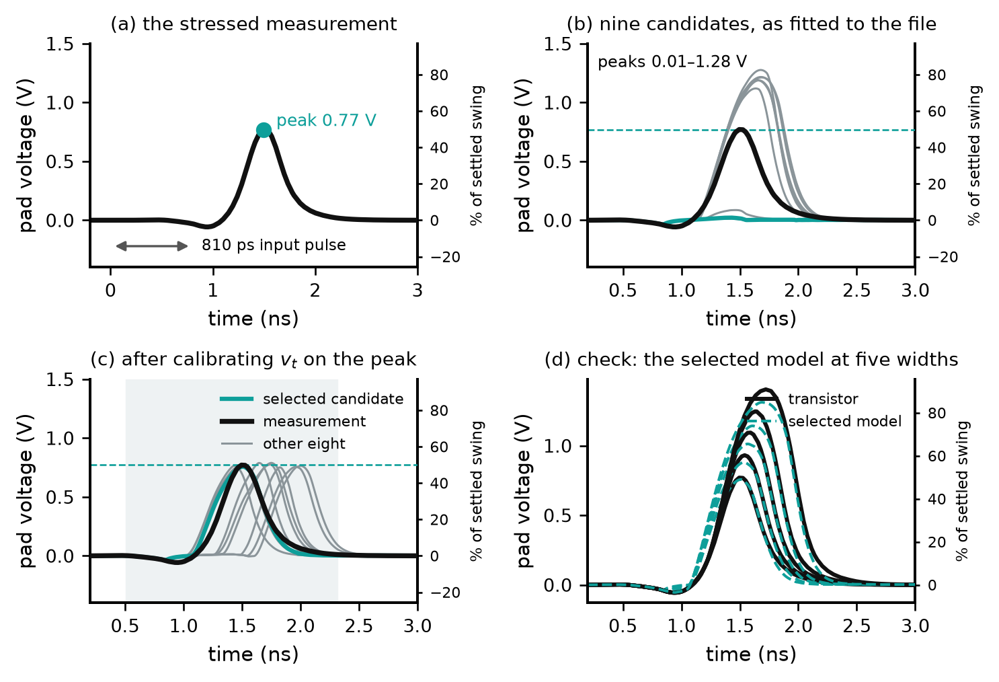

*Fig. 15. Use of the stressed measurement on ex2 (file-only setting). (a) The measurement: pad voltage for an 810 ps pulse. (b) The nine candidates as fitted to the file, driven by the same pulse; dashed: the measured peak. (c) After calibration of each threshold on the peak; shaded: the window of (29); teal: the selected candidate. (d) The selected model at the five widths of Section V.*

*Calibration (step 3).* The stage threshold decides how much of a short pulse survives each stage and so sets the height of the model's pad pulse; it is also the parameter the file determines worst. For each candidate, with  `V̂`  the measured peak, the peak error

```
e(v_{t})≜(max_{t}V_{pad}^{model}(t;v_{t})−V̂)/(V̂), e(v_{t}^{cal})=0  (28)
```

is driven to zero by bisection of  `v_{t}`  on  `[0,0.7]` , all other parameters held at their values from (26); each evaluation is one circuit simulation of the complete model, three bracket the interval and seven bisect it. If the threshold cannot bracket the peak,  `s_{up}`  and  `s_{dn}`  are scaled together within  `[0.5,2]`  instead. The threshold is used rather than the rates because the rates were fitted to reproduce the full swing and moving them degrades it. Fig. 16 shows the calibration on ex2's selected candidate: the peak error is +40 % at  `v_{t}=0` , rises to +59 % near 0.25, and falls steeply above 0.55 to -97 % at the bound, where the chain extinguishes the pulse; the bisection needs only the sign and ends at  `v_{t}=0.632` , from a fitted value on the bound (-97 % before).

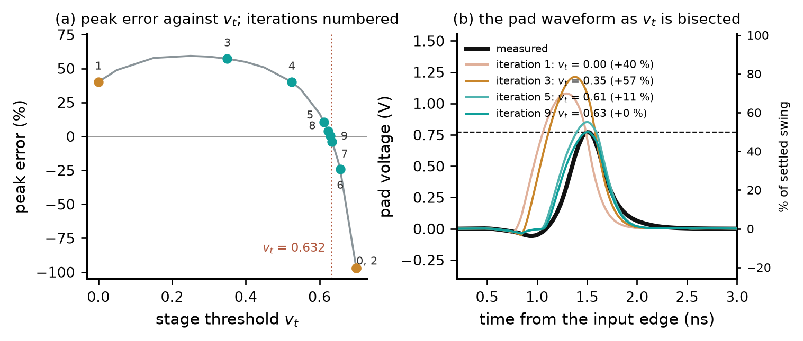

*Fig. 16. The calibration (28) on ex2's selected candidate ( `K=3` , map (0.5, 0.7), file-only setting), 810 ps pulse. (a) The peak error against  `v_{t}`  from a dense sweep, with the ten runs of the procedure numbered (orange: bracketing; teal: bisection). (b) The pad waveform at four of them against the measurement; dashed: the measured peak.*

*Selection (step 4).* After calibration every candidate reproduces the measured peak (Fig. 15(c)), so the peak can no longer distinguish them. They still differ in when the pulse arrives and how it returns, between 0.11 ns early and 0.30 ns late on ex2 (the lag of a candidate is the time shift of its waveform that best matches the measurement over the pulse, positive when the model is late). The candidate is chosen by the waveform error over the pulse and its return,

```
(K,v_{t,map},a)^{⋆}=argmin E_{W}
E_{W}=rms_{t∈W}[V_{pad}^{model}(t)−V_{pad}^{meas}(t)]
W=[t_{f}−0.3 ns, t_{f}+1.5 ns]  (29)
```

where  `t_{f}`  is the falling edge of the input pulse (the shaded interval of Fig. 15(c)); the window was chosen once and not tuned. One waveform is thus used for two decisions, read from two features of it: the threshold from its height, the stage count and map shape from its shape. The peak cannot serve for the second decision: at the calibration width every candidate now matches it, and the peaks at the other widths would need measurements the method does not have. They would also mislead. Over the twelve buffers, the mean pad-waveform error at the five test widths is 52.3 mV for the candidates chosen by (29), against 51.7 mV for the best candidate each grid contains (chosen with knowledge of all five widths, the floor of any selector) and 217.3 mV for the candidates with the smallest worst peak error over the five widths, which reach their peaks by arriving 155–300 ps late. A correct height reached at the wrong time is what the waveform error penalizes and the peak error cannot see. The measurement can only choose among the candidates it is offered: if the true map is unlike all three shapes, or the true stage count lies outside the band, it selects the least wrong candidate.

### F. The Procedure End to End on Ex2

Table VI collects what the procedure did on ex2 in the file-only setting. Step 0: the file declares  `C_{comp}`  = 5.0 pF, with which the solved  `K_{u}`  peaks at 1.24; the estimate of Section IV-B gives 2.64 pF, used from here on. Step 1: the fit at the first candidate shape, (0.50, 0.70), with which the band is determined, gives residuals .0920, .0360, .0233, .0229, .0212, .0202 for  `K`  = 1 to 6, so the band (27) is  `K`  ∈ {3, 4, 5}. Step 2: nine candidates. Step 3: the measured peak is 0.77 V; the candidates' peaks before calibration run from 0.01 to 1.28 V, and after it all are within 2.5 % of the peak. Step 4: the waveform rms (29) runs from 56 to 400 mV across the nine; the selected candidate,  `K`  = 3 with shape (0.5, 0.7), has 56 mV and arrives 7 ps early. Its worst peak error over the five stressed widths, which the procedure cannot know, is 8.3 %.

*TABLE VI*

*The nine candidates of ex2 through steps 2–4 (file-only setting). Columns 3–4: the fit (26). Peak before: as fitted, 810 ps pulse (measured 0.77 V). Then, after calibration at that width:  `v_{t}` , peak error, rms (29) and lag (positive: late). Worst: peak error over the five widths, not available to the procedure*

| `K` ​ | **Shape** | `v_{t}`  fit | **Residual (26)** | **Peak before (V)** | `v_{t}`  cal. | **Peak err. (%)** | **rms (29) (mV)** | **Lag (ps)** | **Worst (%)** |  |
|---|---|---|---|---|---|---|---|---|---|---|
| 3 | (0.4, 0.6) | 0.700 | 0.0233 | 0.01 | 0.604 | -0.7 | 132 | -108 | 8.0 |  |
| 4 | (0.4, 0.6) | 0.485 | 0.0227 | 1.12 | 0.577 | +2.3 | 150 | +97 | 3.0 |  |
| 5 | (0.4, 0.6) | 0.265 | 0.0225 | 1.28 | 0.544 | -2.5 | 319 | +257 | 2.5 |  |
| 3 | (0.4, 0.9) | 0.700 | 0.0236 | 0.09 | 0.621 | -0.1 | 80 | -21 | 9.8 |  |
| 4 | (0.4, 0.9) | 0.570 | 0.0219 | 1.19 | 0.675 | +0.6 | 216 | +186 | 3.5 |  |
| 5 | (0.4, 0.9) | 0.098 | 0.0211 | 1.22 | 0.544 | -1.9 | 383 | +300 | 2.8 |  |
| 3 | (0.5, 0.7) | 0.700 | 0.0233 | 0.02 | 0.632 | -1.8 | 56 | -7 | 8.3 | selected |
| 4 | (0.5, 0.7) | 0.407 | 0.0229 | 1.19 | 0.571 | +2.4 | 249 | +216 | 2.4 |  |
| 5 | (0.5, 0.7) | 0.065 | 0.0212 | 1.21 | 0.561 | -0.8 | 400 | +300 | 2.3 |  |

Three things can be read off Table VI. The fit residuals of the nine candidates lie within 12 % of each other, so the file does not rank them; their peaks before calibration do. After calibration every candidate matches the peak, so the peak no longer ranks them and the waveform must. The  `K`  = 4 and 5 candidates would have scored 2.3–3.5 % on the worst peak over the five widths against 8.3 % for the selected one, but they arrive 97–300 ps late at the calibration width, where the selected one is 7 ps early. The waveform error (29) penalizes the late arrival and the peak score does not, so the two criteria disagree on ex2; the selector cannot know the peak errors at the other widths in any case, and (29) chooses timing.

## V. Verification

Two claims are verified separately: that the stage law, fitted to a complete transition only, predicts how the gate responds to a truncated pulse; and that the complete method, built from the file and one measurement, reproduces the pad voltage of stressed pulses. Both compare the model with the transistor-level netlist from which the IBIS file was extracted, the golden-waveform check of [7].

### A. Gate Level: The Stage Law Extrapolates from Full Swing to Truncated Pulses

This test uses the internal gate node of the transistor netlist (n4 of ex2, vout7 of inv_chain) and is therefore not available to a user of the method; its purpose is to test (19).  `K`  identical stages are fitted in the gate domain, that is, the chain output is compared directly with the probed full-swing gate and no map is involved (a third setting, used only here); the chain is then driven by the stressed input and compared with the probed stressed gate at the five test widths. No stressed data enters the fit. The comparison is linear superposition: the node's response to the short pulse predicted by adding its probed full-swing rising response and its full-swing falling response delayed by the pulse width, which is exactly what any linear model of the predriver would give.

*TABLE VII*

*Peak of the stressed gate: measured, the stage law fitted at full swing only, and linear superposition (pulse widths ex2 810–975 ps, inv_chain 104–135 ps)*

| **Buffer, model** | **narrowest** | **2nd** | **3rd** | **4th** | **widest** | **Full-swing residual** |
|---|---|---|---|---|---|---|
| ex2, measured | 0.758 | 0.797 | 0.838 | 0.880 | 0.936 |  |
| ex2, stage law,  `K`  = 3 | 0.756 | 0.782 | 0.813 | 0.847 | 0.898 | 0.0066 |
| ex2, stage law,  `K`  = 2 | 0.303 | 0.332 | 0.372 | 0.426 | 0.538 |  |
| ex2, linear superposition | 0.926 | 0.932 | 0.940 | 0.951 | 0.968 |  |
| inv_chain, measured | 0.879 | 0.935 | 0.972 | 0.992 | 1.003 |  |
| inv_chain, stage law,  `K`  = 7 | 0.701 | 0.832 | 0.913 | 0.961 | 0.987 | 0.0032 |
| inv_chain, stage law,  `K`  = 5 | 0.000 | 0.000 | 0.000 | 0.000 | 0.810 | 0.0037 |
| inv_chain, stage law,  `K`  = 3 | 0.000 | 0.000 | 0.000 | 0.000 | 0.000 | 0.0141 |
| inv_chain, stage law,  `K`  = 9 | 0.942 | 0.954 | 0.967 | 0.981 | 0.992 | 0.0032 |
| inv_chain, linear superposition | 0.999 | 1.000 | 1.002 | 1.005 | 1.008 |  |

On ex2 the stage law with the netlist stage count is within 0.04 of the measured peak at every width, where linear superposition is off by 0.17 at the narrowest pulse (Table VII, Fig. 17(a));  `K=2`  gives 0.30–0.54, far below the measurement. On inv_chain the stage law follows the measurement at the three widest pulses (within 0.06) and undershoots at the two narrowest, by 0.18 at 104 ps, the partial-drive regime in which approximation A2 is active (Section VI). The other rows show the consequence of the flat residual of Section IV-D: with  `K=5`  the chain extinguishes 4 of the five stressed pulses and with  `K=3`  it extinguishes 5, at full-swing residuals that the file cannot separate from that of  `K=7` ; with  `K=9`  the pulse passes almost unattenuated. A control establishes that the nonlinearity is a property of the buffers and not of the fit: on io_buf, at its five test widths (1505–2354 ps; its transition is slower), every probed predriver node and the pad follow linear superposition (pad peak 0.373 measured against 0.371 predicted), whereas the same test fails on the output gate of ex2 (0.758 against 0.926) and at the pad of inv_chain (0.490 against 0.853).

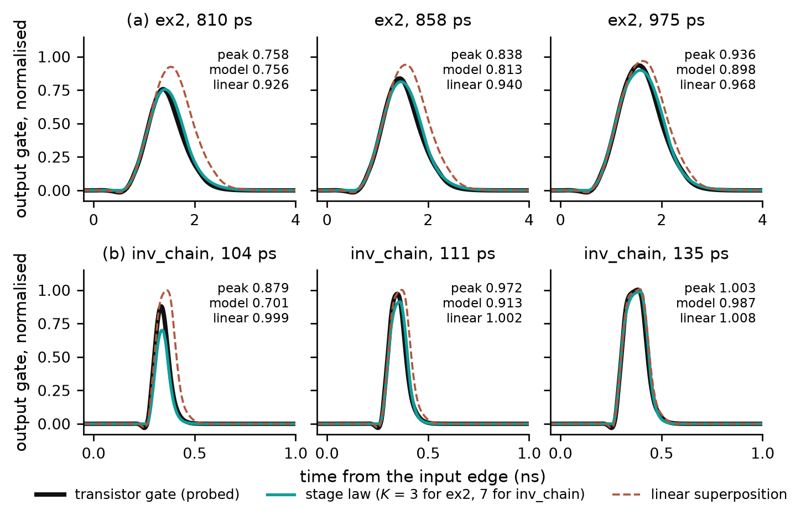

*Fig. 17. Stressed gate of the transistor netlist against the stage law fitted at full swing only, and against linear superposition, at the narrowest, middle and widest of the five pulse widths. (a) ex2. (b) inv_chain.*

The file-only model's internal gate, which is never fitted to anything, can also be compared with the probed gate on these two buffers. Its stressed peak is 0.03–0.05 low on ex2 and 0.01–0.08 low on inv_chain, and it leads the real gate by 56–74 ps and 12–20 ps; on ex2 it returns to zero faster than the real gate, and the map absorbs the difference at the pad. The structure of (19) produces an internal gate that resembles the transistor's, while its numbers remain effective parameters.

### B. Pad Level: The Complete Method on Twelve Buffers

The procedure of Table III was applied to the twelve test buffers. For each buffer the model was built from its IBIS file and one transistor-level pad waveform at the pulse width giving about 50 % of the settled swing, with  `C_{comp}`  estimated from the file as in Section IV-B. The model was then simulated at five pulse widths (about 50 to 90 % of the settled swing) into the same load and compared with transistor-level simulation. The score is the worst peak error over the five widths, with the peak error defined as in (28). The calibration width is one of the five, so the score is not entirely held out. HSPICE's native IBIS element with the same file is the baseline.

*TABLE VIII*

*Pad-level result on the twelve test buffers (worst of five stressed pulse widths, file-only setting; *: native with its V–T tables resampled onto 200 rows, see text)*

| **Buffer** | Netlist  `K` | Selected  `K` | **Selected map shape** | **Proposed: worst peak error (%)** | **Native IBIS: worst peak error (%)** |
|---|---|---|---|---|---|
| ex2 | 3 | 3 | (0.5, 0.7) | 8.3 | 70.7 |
| ex2_base | 3 | 3 | (0.5, 0.7) | 7.0 | 62.1* |
| ex2_slowpre | 3 | 3 | (0.5, 0.7) | 5.4 | 34.1* |
| ex2_skewp | 3 | 3 | (0.5, 0.7) | 10.0 | 51.8* |
| ex2_weak | 3 | 3 | (0.5, 0.7) | 8.7 | 60.5* |
| ex2_nomiller | 3 | 3 | (0.5, 0.7) | 7.2 | 64.2* |
| inv_chain | 7 | 6 | (0.4, 0.9) | 5.1 | 87.2 |
| inv_base8 | 7 | 7 | (0.4, 0.6) | 8.4 | 66.8 |
| inv_stage4 | 3 | 3 | (0.4, 0.9) | 3.2 | 99.8 |
| inv_skewp | 7 | 7 | (0.4, 0.6) | 8.1 | 37.3 |
| inv_weak | 7 | 7 | (0.4, 0.6) | 4.1 | 35.8 |
| io_buf | 1 | 1 | (0.5, 0.7) | 7.7 | 20.4 |

The proposed model is within 10 % on all twelve buffers (range 3.2–10.0 %, mean 6.9 %; Table VIII, Fig. 18, Fig. 19). The native element's worst peak error is 20–100 % on the twelve buffers. The selected stage count equals the netlist count on eleven buffers (inv_chain selects 6 against 7).

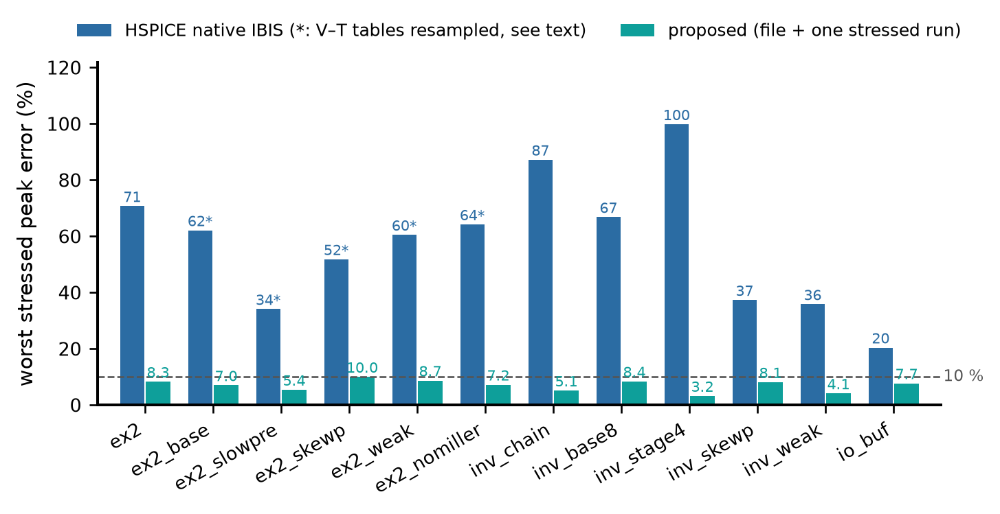

*Fig. 18. Worst stressed peak error over the five test widths on the twelve buffers: HSPICE's native IBIS element against the proposed model built from the file and one stressed measurement. Starred: native with its V–T tables resampled, as described in the text.*

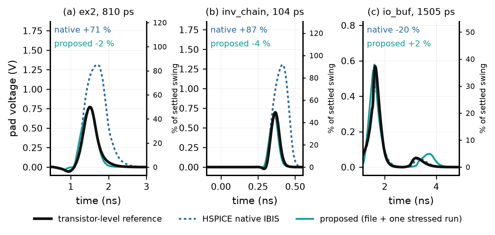

*Fig. 19. Pad voltage for the narrowest stressed pulse of three buffers: transistor-level reference, HSPICE native IBIS, and the proposed model built from the file and one stressed measurement. Percentages are peak errors against the reference.*

*The native element on the variant files.* On the five ex2 variants the native element produced no waveform with the files as generated; the starred entries of Table VIII and Fig. 18 come from the same files with every V–T table resampled onto 200 rows (13 ps on ex2_base) and nothing else changed. Fig. 20 shows the cause. The variant files sample their tables at 2.2–2.7 ps, three times finer than the shipped ex2 file, and the resampled table is the same waveform (Fig. 20(a)); before the edge the variant file and the shipped file both carry about 0.2 mV rms of ripple about their trend. The element's two-waveform solver [4] latches  `K_{u}`  near 0.1 when the reversal of a short pulse lands in that lead-in and never recovers, without a warning (Fig. 20(b)). Four observations locate the fault: every as-generated file runs under a 10 ns pulse; holding the first 300 ps of every table flat revives every variant; adding 0.3 mV rms of noise to the first nanosecond of the shipped ex2 tables resampled at 2.7 ps kills the element on the shipped file, where 0.1 mV does not and the same 0.3 mV at 300 rows does not; and the converter's own solution of the same files is unaffected. The solver fails on sub-millivolt sample-to-sample variation when the samples are closer than a few picoseconds, which is not a property of the buffers or of the files' electrical content. The revived score depends on the edit (the flat lead-in, which also removes the feedthrough dip that precedes the edge, gives 43–56 % on the three variants tested; 100 or 200 rows 52–64 %), so Table VIII uses the least invasive edit, and the native element then fails on the variants as it does on the shipped ex2, by replaying the coefficients of a complete transition against a pulse that interrupts it. What the solver does with the ripple is not visible from outside; the runs above characterize it and nothing more is claimed.

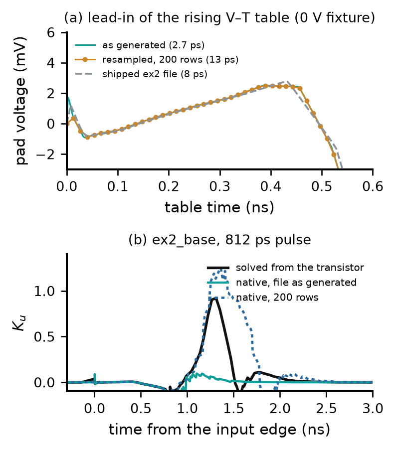

*Fig. 20. Why the native element has no valid run on the variant files, on ex2_base. (a) The lead-in of the rising V–T table into the 0 V fixture: as generated (2.7 ps), resampled onto 200 rows (13 ps) and, for comparison, the shipped ex2 table (8 ps). (b) The element's  `K_{u}`  under the 812 ps pulse on the as-generated and on the resampled file, against the  `K_{u}`  solved from the transistor's own fixture runs (undefined within about 90 ps of the reversal).*

### C. Limits of the Evidence

The gate-level test establishes that the structure of (19) extrapolates from full swing to truncated pulses when fitted to the true gate; the pad-level test establishes the accuracy of the file-only procedure, in which the gate is never observed. Both have a narrow statistical base: the five pulse widths of a buffer sample one stressed trajectory and are strongly correlated, so the evidence rests on the number of buffers. The pad-level test covers single high-going pulses, one load and the typical corner; pulse trains, low-going pulses, other loads and other corners are outside it. The map-shape grid and the band rule (27) were chosen on these same twelve buffers.

## VI. Discussion: Approximations and Limits

*TABLE IX*

*Approximations of the model*

| **Label** | **Approximation** | **Introduced at** | **What it removes** | **Evidence** |
|---|---|---|---|---|
| A0 | One  `V_{TH}` ,  `α` ,  `V_{D0}`  for both devices of a stage | (13)–(14) | Per-device parameters | As in [5, Sec. VI]. Table II: the N and P devices differ ( `x_{0}`  0.34 against 0.57 on inv_chain) |
| A1 | `p`  in place of  `α` , with  `p=1` ​ | (17) | The measured  `α`  (Table II) | Not identifiable from the file (Section IV-D) |
| A2 | `x_{0}g^{α/2}→x_{lin}` , with  `x_{lin}=0.45` ​ | (18) | Drive dependence of the saturation boundary | Not identifiable from the file; candidate cause of the inv_chain undershoot in Table VII |
| A3 | `K`  identical normalized stages | (20) | `4(K−1)`  free parameters | Free fit fails (Section IV-D);  `K`  selected by (29) |
| A4 | Map shape taken from a grid of three | (22), (26) | Trade-off between gate and map | Selected by (29); grid chosen on the test buffers |

Table IX collects the approximations. Everything else in (19) is inherited from (1) and (2)–(5): the threshold, the constant-current ramp, the straight-line resistive tail and the two-device structure; (24) is the existing model's. Two limits deserve emphasis. First, the method has four built-in constants,  `x_{lin}` ,  `p` , the three map shapes and the band rule, whose values were chosen with transistor-level knowledge of the twelve test buffers; whether they suit buffers outside the set has not been tested, and the map shapes are the least well founded element. Second, one limit is inherited from the device model: [5] states that the α-power law does not reproduce the region near and below threshold, and its delay analysis neglects the opposing device, justified for fast inputs [12]; a truncated pulse holds the stages near  `v_{t}`  with both devices conducting, outside the regime for which [5] validated the model, so the accuracy of (19) there rests on the tests of Section V and not on [5].

Several points are open. A drive-dependent boundary (15) in place of A2 reduces the inv_chain undershoot at the gate (mean peak error 0.077 to 0.016) but is neutral on ex2 and cannot be identified in the  `K_{u}`  domain, so it has not been adopted. The pad-level score includes the calibration width, and the selector costs about six points of peak error on ex2 against the best candidate in its grid. Two of the three Nelder–Mead starts stop in side minima on ex2; more starts, or a global stage, would make step 1 more robust and has not been tried. Two inputs are not yet given by a rule: whether  `x_{lin}`  is fitted or fixed, decided per buffer here (fixed on ten, fitted on two) and not re-run uniformly; and the choice between one chain and two (Section III-B), made from the netlists.

## VII. Conclusion

An IBIS file records complete transitions, and a model that replays its coefficients against time cannot follow a pulse that the predriver cuts short. Modeling the predriver as a chain of stages obeying a law derived from the α-power MOSFET model, and reading the conducting fraction from the gate through a static map, gives a model whose coefficients follow the gate. The file fixes the stage rates and nothing else that matters under partial drive; one measured short pulse fixes the rest, its peak through the threshold and its shape through the choice among nine candidates. On twelve test buffers the result is within 10 % of the transistor-level pad peak at five pulse widths, where the native element is at 20–100 %. The cost is one measurement and four built-in constants; the next steps are a test outside the buffers those constants were chosen on, pulse trains and other loads, and a more robust search in step 1.

## References

[1] IBIS Open Forum, *I/O Buffer Information Specification (IBIS), Version 7.1*, Dec. 2021. [Online]. Available: https://ibis.org/ver7.1/

[2] IBIS Open Forum, *IBIS Modeling Cookbook for IBIS Version 4.0*, Sep. 2005. [Online]. Available: https://ibis.org/cookbook/

[3] Y. Wang and H. N. Tan, “The development of analog SPICE behavioral model based on IBIS model,” in *Proc. 9th Great Lakes Symp. VLSI*, 1999, pp. 101–104.

[4] Synopsys, *PrimeSim HSPICE User Guide: Signal Integrity Modeling and Analysis*, Version T-2022.06, Jun. 2022, ch. 8.

[5] T. Sakurai and A. R. Newton, “Alpha-power law MOSFET model and its applications to CMOS inverter delay and other formulas,” *IEEE J. Solid-State Circuits*, vol. 25, no. 2, pp. 584–594, Apr. 1990.

[6] I. S. Stievano, I. A. Maio, and F. G. Canavero, “Mπlog: Macromodeling via parametric identification of logic gates,” *IEEE Trans. Adv. Packag.*, vol. 27, no. 1, pp. 15–23, Feb. 2004.

[7] R. Leventhal and L. Green, *Semiconductor Modeling: For Simulating Signal, Power, and Electromagnetic Integrity*. New York, NY, USA: Springer, 2006.

[8] H. Shichman and D. A. Hodges, “Modeling and simulation of insulated-gate field-effect transistor switching circuits,” *IEEE J. Solid-State Circuits*, vol. SC-3, 1968.

[9] E. Hairer, S. P. Nørsett, and G. Wanner, *Solving Ordinary Differential Equations I: Nonstiff Problems*, 2nd ed. Berlin, Germany: Springer, 1993.

[10] H. Vogt, G. Atkinson, D. Warning, and P. Nenzi, *Ngspice User’s Manual, Version 46*, Mar. 2026. [Online]. Available: https://ngspice.sourceforge.io/docs/

[11] J. A. Nelder and R. Mead, “A simplex method for function minimization,” *Comput. J.*, vol. 7, no. 4, pp. 308–313, 1965.

[12] N. Hedenstierna and K. O. Jeppson, “CMOS circuit speed and buffer optimization,” *IEEE Trans. Computer-Aided Design*, vol. CAD-6, no. 2, pp. 270–280, Mar. 1987.
